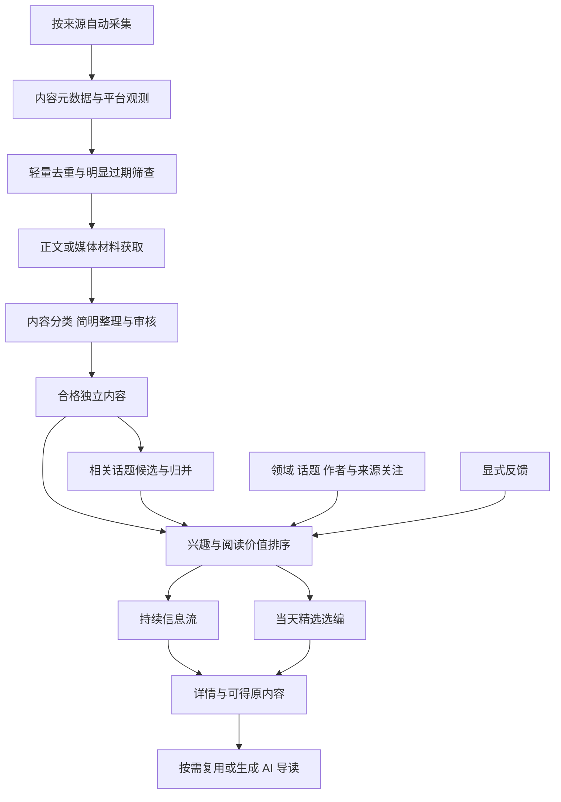

# Unspun 重构实现方案草案

状态：本文件保留 2026-10-15 方案建议及当时的代码现状，不作为当前已交付能力清单。R1 已按[最终用户验收](acceptance/r1-final-acceptance-2026-10-19.md)结案；当前接续以 [R2 实施设计](superpowers/specs/2026-10-19-r2-topics-and-recommendation-design.md)、[任务板](tasks/r2.md)和 [D-029](decisions.md)为准。R2-00–03 已交付；[CL-00 只读盘点](acceptance/cl-00-inventory-2026-10-20.md)已完成，[CL-01 退役](acceptance/cl-01-retirement-2026-10-20.md)隔离验收通过、待发布，随后接续 R2-04/05 等产品批次；R3 未启动。需求依据为[新版需求](requirement.md)和[产品定义](product-definition.md)。本方案保留现有工程基础，重做内容发现、组织、推荐和阅读的核心流程。

## 实现目标

用同一套内容底座承接自动发现、当天精选、持续信息流、话题详情和独立内容详情。先让真实内容经过完整阅读路径，再逐步补齐国内来源与质量，避免只交付一组新页面。

第一阶段包含基本兴趣表达与反馈、独立文章和视频推荐、话题整理。手动收集和影响预测以后再加。

## 现状与复用边界

| 现有部分 | 已有能力 | 重构建议 |
| --- | --- | --- |
| React、FastAPI、Postgres 与 pgvector | 页面、API、数据库、向量检索基础 | 继续使用，按业务职责拆模块 |
| RSS 与 RSSHub | 订阅获取、解析、来源配置与抓取日志 | 复用适配器，增加不同输入形式和独立采集调度 |
| 网页抽取 | 尝试获取正文，失败时回退订阅摘要 | 保留获取和来源依据，补作者、内容类型与正文完整度；站内阅读需要另做正文结构处理 |
| 摘要、引用、语义审核与费用记录 | 有依据的中文整理及调用记账 | 复用证据校验和账务，按内容类型重做生成与准入契约 |
| 事件聚类与评分 | 增量质心归类、事件级重要性和排序 | 向量能力作为候选检索；独立内容可推荐，聚类不能成为所有内容的前置条件 |
| 事件流和日报 | 事件分页、排序偏好、固定日报快照 | 增加混合信息流和当天精选，历史接口与快照单独保留 |
| 后台与访问部署 | 来源、内容、任务、费用查询及 Access | 继续使用，按新处理阶段补充状态，避免先重建完整后台 |

现状来自本地代码检查，不代表本轮复验了生产状态。当前 `Article.event_id` 允许为空，但前台查询只服务事件，缺少独立内容阅读 API、领域或话题关注及内容反馈。不能把数据库中有正文等同于已支持站内全文阅读。

## 内容与数据结构

逻辑上把内容、话题、热度观测、兴趣和推荐结果分开。具体字段与索引在各交付批次确定，下面是建议边界。

| 对象 | 建议实现 | 关键约束 |
| --- | --- | --- |
| 内容 | 增量扩展现有 `articles`，API 统一称 content | 保存类型、作者、原始时间、正文依据与完整度；没有话题也能入选 |
| 内容特征与生成版本 | 保存领域、主题、当前价值、摘要与导读及其输入版本 | 准入、重要性、兴趣与生成审核分别记录；原文修改使相关派生结果失效 |
| 来源观测 | 保存平台条目 ID、原始链接、规范内容 ID、榜单或互动快照 | 正文去重后仍保留传播关系，观测时间不冒充发布时间 |
| 话题与内容关系 | 新增 topics 与 topic_items，支持事件和议题 | 领域独立；旧 events 只在验证成员与语义后映射，不能全量视为正确话题 |
| 关注与反馈 | 保存领域、话题、作者或来源关注，以及对目标的显式反馈 | 作者标识带平台，反馈可撤销；不把未点击视作不喜欢 |
| 当天精选版本 | 新增选编记录，引用内容或话题及入选理由 | 与旧 digests 分开；同一版本可稳定阅读，更新形成新版本 |
| 可恢复任务 | 用 Postgres 保存任务、去重键、领取状态、重试与预算记录 | 采集、处理、导读和选编分开领取，失败可恢复 |

先用关系字段和少量有契约的 JSON 保存演进中的特征，不预先建设通用知识图谱或大规模推荐训练系统。旧 articles、events、digests、账务和评测数据通过增量方式保留。

## 采集到推荐的处理流程

第一步保留元数据，正文抓取失败也有可追踪的候选。URL、平台 ID、内容指纹与明确转载先低成本处理；时间不明或适用性不确定的内容保留待判定，不能一律按年龄删除。

分类、主题标签、时效判断和卡片整理尽量合并使用材料，避免每个判断独立付费。只有合格且需要语义检索的内容才进入 embedding。沿用摘要后 embedding 的顺序作为起点，其他顺序须有同样本成本和质量收益。

热榜可以先提供发现线索，再获取相关可读材料；榜单标题本身不能被扩写成事实或完整讨论。文章、评论和视频按内容性质审核，不要求每个对象都有多篇新闻证据。

导读优先为入选内容准备，其他内容进入详情后复用或排队生成；不对全部采集结果预先做深度分析。生成任务按内容指纹、提示词和模型版本去重，读取与重试不能反复触发同一付费任务。

## 来源选择与验证

以用户指定的[首批信息源计划](source-plan.md)为接入优先范围，按内容用途补覆盖，不先追求固定源数。指定来源的栏目和可用性仍需验证，以下同时保留此前内容与视频候选。

| 用途 | 候选来源 | 本轮证据与下一步 |
| --- | --- | --- |
| 综合要事与公共议题 | 新华网、早报中国与国际、南方周末、澎湃、人民日报、新京报、界面、网易、腾讯；原有领域来源按缺口补充 | 部分已有配置；新增栏目、原始发布方、时效与正文逐项验证 |
| AI 与科技 | 36氪快讯和文章、量子位、专业媒体与少量技术一手发布 | 36氪需补文章范围；量子位公开 RSS 初查一次可解析，其他路径需验证 |
| 好文章与独立创作 | 知乎日报、豆瓣、少数派、三联、领域作者及优质栏目 | 知乎日报与豆瓣书影 RSS 已有有限端点探测；完整度、时效和作者能力另验 |
| 财经商业 | 雪球、财富中文网，结合新闻类财经内容 | 上游有候选路径；雪球所核对路径含浏览器依赖，需实际验证 |
| 公共讨论 | 知乎热榜、微博等 | 话题发现与讨论正文分开验证；微博热搜路径和运行条件待验证 |
| 视频 | B 站分区榜单与作者更新 | 排行榜上游路由存在浏览器依赖，运行镜像及作者更新路径另验 |
| 重要领域缺口 | 科学、健康、气候能源等领域媒体与机构发布 | 按覆盖清单逐项找样本，不默认现有综合源已覆盖充分 |
| 国际补充 | BBC、纽约时报、华尔街日报 | 现有国际 RSS 本轮返回成功，中文栏目、领域覆盖与可得正文继续验证 |

具体观测与来源链接见[来源初查](research/2026-10-15-source-feasibility.md)。例如 [RSSHub 知乎路由](https://github.com/DIYgod/RSSHub/blob/master/lib/routes/zhihu/hot.ts)的输出不等于回答全文；[B 站排行榜路由](https://github.com/DIYgod/RSSHub/blob/master/lib/routes/bilibili/ranking.ts)声明浏览器依赖，接入计划必须包含运行条件验证。

先做候选采集与正文提取样本，再在实际部署环境跨时段复验。浏览器或凭证依赖的来源需要真实验证维护负担，不能把临时可用当长期覆盖。某条路径不可用时寻找同类覆盖，仍无法覆盖的部分明确记录缺口。

## 话题归并与重复处理

用领域、主体、时间和已有向量先召回少量话题候选，再判断是否属于同一事件或议题。人物、企业相同只是候选信号，同主题但不同事件不自动归并；不确定的内容先独立展示。

独立内容与话题卡片共享来源关系。一个版面中优先展示话题概况，具有独有观点或阅读价值的文章可另行入选；相同正文或无新增价值的转载不会以多个卡片重复占位。新进展记录材料依据和时间，不由数据库更新时间推断。

第一阶段只为需要持续整理的事件或议题建立话题，不要求为每篇文章生成专题。保留后台纠正成员关系的增量能力，但不把完整操作平台作为首个阅读闭环的前置条件。

## 个性化与选编

先用显式关注、主题或领域匹配、作者与来源偏好形成初始相关性，显式反馈逐步修正。复用现有向量能力辅助匹配；不先训练个性化模型，也不依赖阅读时长或隐式已读状态。

排序先保证内容合格，再分别计算兴趣、重要性、热度、当前价值和重复曝光等特征。重要动态和兴趣内容分别召回后合并，按领域与内容多样性调整，避免只取一个总分前若干条。单语言或国内来源不能因此被视为与用户较少相关，旧版跨地区折扣需重新评测。

当天精选从混合候选再选编，兼顾当天重要动态和可独立消费的好内容，保存入选原因及版本。按已确认原则随重要新增适度更新，已有条目仅在材料或选择有实质变化时改版，不跟随每次抓取抖动。首轮样本确定条数、更新阈值或间隔和重复曝光规则。

混合流默认推荐、可切换最新，以及精选随重要新增更新，已由用户在 D-024 确认。类型适配的准入和旧版折扣调整仍为方案建议，分别涉及 D-013/D-022 与 D-010。具体实现与评测完成后再切换运行规则。

## 页面与接口建议

首页提供当天精选和持续信息流，关注设置为辅助入口；内容和话题有独立详情。先用真实采集样本验证卡片密度、正文阅读、返回位置和手机交互，再确定视觉与导航。

| 接口职责 | 建议路径 | 返回重点 |
| --- | --- | --- |
| 混合信息流 | `/api/feed` | 内容或话题卡片、推荐或最新、稳定游标和排序版本 |
| 当天精选 | `/api/selection/today` | 选编版本、更新时间、条目与理由 |
| 独立内容阅读 | `/api/contents/{id}` | 类型、作者、原始时间、正文完整度、导读与原内容入口 |
| 话题阅读 | `/api/topics/{id}` | 概况、依据明确的进展或讨论、相关内容 |
| 关注 | `/api/interests` | 领域、话题、作者与来源偏好及实际接入状态 |
| 反馈 | `/api/feedback` | 目标、态度和可撤销版本 |

接口命名为草案，首批实施时固定契约；旧 `/api/events` 和 `/api/digest` 保留给旧入口。API 读写继续校验现有 Access 身份，不在本轮新增账号体系。

正文使用处理过的阅读结构；如引入 HTML 保留图片和排版，需有清理后的展示格式。原文、AI 导读与源摘要分别呈现，正文可读不等于全文完整。生成内容的有效性基于其材料与版本，不以重要性高或热度高绕过审核。

## 调度与成本

复用现有 worker 和 Postgres，为采集、正文、付费处理、导读及选编拆独立任务。按源周期、失败退避和有限并发调度，任务有唯一去重键、领取期限、重试与状态。慢来源不拖住其他来源，选编也不等待所有任务完成。

沿用现有模型档位与供应商、调用记账和预算边界，先测每个阶段的成本。新增任务需要共享总额约束与预算预留，调用后按实际费用核销；当前审核模块的滚动限额不能被误认为所有 LLM 用量的总预算。费用已发生但任务失败仍要记录，调用结果未知的部分保留待核对状态，预算不足与内容拒绝分开。

首轮评估同时报告每百条候选、每条入选内容和每次新导读成本，以及按实际流量推算的月度范围。超出既有预算时优先减少重复和无效处理、缩减候选或延后导读，不以提预算作为默认解决方式。

## 迁移与交付

旧需求与路线图已有完整历史副本，旧任务板与生产验收证据不改写。数据增量迁移，旧事件不自动标记为新版合格话题，旧导读与审核不自动补造。历史日报继续按原快照读取。

先增加新模型、适配器和 API，再接独立预览入口；新旧阅读入口可并存验证。新版可切换上线后再移除无用运行路径，不在首批删除旧表或批量重写历史。全量历史重处理不是启动依赖，必要的定向补处理有范围、预算与记录。

实施顺序和每批出口见[新版路线图](roadmaps.md)。评分、生成与话题判断先固定真实样本及基线；保留旧事件集已有用户标签，补入文章、视频、讨论和被过滤的内容。代码测试验证契约与恢复，真实阅读评测验证是否选得对。

## 本轮交付边界

本轮完成定义、需求与实现方案草案，以及有限的来源初查；没有修改运行代码、来源配置、模型或生产数据。建议默认值及数据结构仍需按真实样本和方案讨论收敛，页面实施继续遵守本地体验验收流程。
