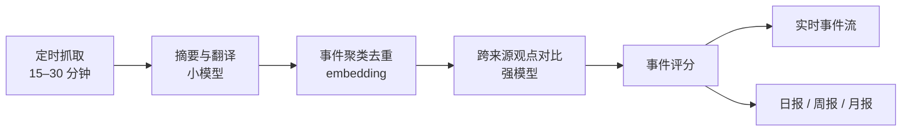

# 个人情报站 · 需求文档

Sep 24, 2026 · @Leon

## 项目概述

一个只给自己用的个人情报站：自动收集中英文的全球热点、趋势、重大新闻和感兴趣领域的知识，由 AI 聚类、对比、评分后呈现，目标是打破信息茧房。

核心设计矛盾是"挖深"与"拓宽"：个性化做得越好，越容易形成新的茧房。因此系统要同时决定给我看什么，以及刻意给我看多少我原本不会点开的内容。

## 用户与使用场景

仅本人使用，不需要账号系统、多用户或推荐冷启动，偏好通过手写配置加反馈来表达。

| 场景 | 设备 | 典型需求 |
| --- | --- | --- |
| 工作日 | 电脑为主 | 快速扫一眼实时事件流，信息量大的观点对比在宽屏上读 |
| 休息时间 | 手机为主 | 读日报、周报、月报，可离线阅读 |

## 内容范围

内容分为兴趣区和破圈区两部分，要解决三种茧房：话题太窄、来源单一、观点单一。

| 分区 | 领域 | 规则 |
| --- | --- | --- |
| 兴趣区 | 科技、AI、经济、政治、医学与健康、气候环境与能源、太空与天文、历史、哲学与思想、社会议题、书籍与文学、影视音乐与艺术 | 不设固定核心领域，每天按 AI 评分排序，受反馈影响 |
| 破圈区 | 基础科学、法律与伦理、设计与建筑、体育、心理学、军事与安全、语言学等 | 按固定比例轮换出现（暂定 20%），不受反馈影响，优先推长期没接触的话题 |

兴趣区已经很宽，所以破圈的重心更多放在观点和来源多样性上，尤其是政治、经济这类立场分歧大的领域。

## 信息源与语言

语言限定中文和英文，信息源池要刻意混搭不同类型，避免依赖少数平台。

| 类型 | 示例 | 作用 |
| --- | --- | --- |
| 主流媒体 | 中英文新闻网站的 RSS 或新闻 API | 重大事件与报道广度 |
| 社区与平台 | Hacker News、Reddit、X（热点 + 关注的博主）、微博热搜、知乎 | 热度与讨论信号 |
| 学术与预印本 | arXiv 等 | 科学与 AI 前沿 |
| 独立博客与评论 | 领域专家博客、Newsletter | 深度观点与少数派声音 |

每个信息源可配置权重，用于评分中的来源质量。部分中文平台有反爬限制，可借助 RSSHub 这类工具。X 的官方 API 需要付费，费用可能超出预算，接入方式（官方 API、RSSHub 等）待确认。具体源清单在后续单独整理。

### 信息源清单与权重（初版已定，后续可调）

**权重原则**

- 权重只衡量可信度和原创性（是否一手报道），不衡量立场。
- 立场多样性由另一套"来源属性"标签负责：地区（中国大陆、港台、美国、欧洲、日本、中东等）和类型（通讯社、公共广播、商业媒体、官方媒体、独立媒体、社区）。观点对比时要求一个事件尽量覆盖不同属性的来源，而不是只看权重最高的几家。
- 社区平台权重最低，因为它的主要价值是热度信号，而不是事实来源。
- 初期控制在 100 个左右的源，宁缺毋滥，之后按实际贡献调整。

**默认权重分档**

| 档位 | 权重 | 来源类型 |
| --- | --- | --- |
| A | 1.0 | 通讯社、一手数据与官方发布（机构公告、论文原文） |
| B | 0.9 | 有独立采编能力的综合媒体 |
| C | 0.8 | 专业垂直媒体、学术期刊的新闻栏目 |
| D | 0.7 | 深度评论、长文杂志、专家博客与 Newsletter |
| E | 0.5 | 聚合与二手转述 |
| F | 0.3 | 社区平台（HN、Reddit、X、微博、知乎） |

单个源可以在所属档位上手动微调，比如某个博客长期质量很高，就上调到 0.8。

**按领域的初版清单**

| 领域 | 英文源 | 中文源 |
| --- | --- | --- |
| 通讯社 | Reuters、AP、AFP | 新华社（官方媒体标签） |
| 综合与国际 | BBC、NYT、The Guardian、The Economist、Al Jazeera、DW、NHK World、Nikkei Asia | 财新、澎湃新闻、界面新闻、联合早报、BBC 中文、端传媒 |
| 科技与 AI | Hacker News、arXiv（cs.AI/CL/LG）、Ars Technica、The Verge、MIT Technology Review、各 AI 实验室官方博客、Simon Willison 博客、Stratechery | 机器之心、量子位、36氪、少数派 |
| 经济 | FT、Bloomberg、WSJ、IMF 与各国央行公告 | 财新、第一财经 |
| 政治与国际关系 | Foreign Affairs、Foreign Policy、Politico | 联合早报、澎湃国际 |
| 医学与健康 | STAT News、Nature/Science 新闻栏目、NEJM、The Lancet | 丁香园 |
| 气候、环境与能源 | Carbon Brief、Inside Climate News、IEA | 界面新闻环境栏目 |
| 太空与天文 | SpaceNews、NASA、ESA | 待补充 |
| 历史、哲学与思想 | Aeon、Psyche | 澎湃思想市场 |
| 社会议题 | The Atlantic、The New Yorker、Pew Research | 三联生活周刊 |
| 书籍、文学与艺术 | NYT Books、London Review of Books、Guardian Culture | 豆瓣书评与影评 |
| 破圈区 | Quanta Magazine（基础科学）、Lawfare（法律）、Dezeen（设计）、War on the Rocks（军事与安全）、The Athletic（体育） | 待补充 |
| 社区平台 | Hacker News、Reddit 各领域版块、X（热点与关注的博主） | 微博热搜、知乎热榜、B 站（热门与关注的 UP 主，首版只取元数据） |
| 长文精选 | The Browser、Longreads | 待补充 |

**需要注意**

- 付费墙媒体（FT、WSJ、Bloomberg、端传媒等）的 RSS 通常只有标题和导语。这不影响它们贡献"报道广度"信号，但摘要和观点对比要依赖可读全文的来源。
- 没有官方 RSS 的站点通过自建 RSSHub 获取。
- 清单里每个源上线前都要逐个验证可用性和抓取稳定性，中文太空和破圈类的源目前偏少，需要后续补充。

**B 站视频源的分期**

- 首版：通过 RSSHub 获取热门、排行榜和关注的 UP 主更新，只用标题、简介、标签和播放互动数据。它作为热度信号参与评分，并在事件下以"相关视频"链接出现。
- 二期：视频内容理解。优先读取视频自带字幕，没有字幕的再做语音转写，然后纳入摘要和观点对比。这一步涉及登录态、接口签名和较大的计算量，风险和成本都明显更高。

M2 实现对账（2026-10-10）：当前清单接入 63 源（49 英文、14 中文），均有地区和类型标签；候选的验证/放弃原因见 `docs/tasks/m2.md`。低于开工确认的 80–100，是否接受 63 源仍待用户决定，未将数量目标自动下调。X、B 站和其余受反爬/无公开路径限制的源继续按后续里程碑评估。

## AI 处理流程

AI 负责从抓取到分析的全链路，我只读结果，但每条结论都必须能追溯到原文链接。



新文章增量归入已有事件或新建事件；只有事件出现实质变化时才重新调用 LLM。观点对比把同一事件的不同来源并排展示，并由 AI 指出分歧点。原文链接是防止 AI 摘要本身带偏见的保险。

M2 首轮审计（2026-10-10）：49 组观点的说法与链接归属全量检查通过，内容抽查发现年份幻觉、短正文摘要扩写和过强的分歧判断，详见 `docs/acceptance/m2-2026-10-10.md`。后续 #43 已于 2026-10-12 合并证据约束、差异分类与语义审核；本地评测和页面验收见 `docs/evaluations/README.md`，生产修复与新样本复验仍待记录。链接正确不等于语义正确。

内容质量优化口径（用户于 2026-10-10 批准）：摘要允许信息不足，仅保留原文支持的事实并保存引用；观点说法需有对应原文证据，差异区分事实冲突、观点差异、覆盖差异、时间进展与不确定。验证引用存在不等于验证语义；固定 30 案例评测需同时衡量正确性、保留信息和成本。摘要生成仍用 flash-lite，标题/摘要与观点使用现有 flash 进行语义审核，额外调用记账并默认受滚动 24h $0.40 审核限额约束，用尽后标明未完成审核并保留原始标题；模型不升至 pro，指纹覆盖实际输入与生成版本；通过受控流程修复受影响事件，历史日报快照保持原样。

## 评分与排序

评分对象是事件而不是单篇文章，且"重要性"与"与我相关"拆成两个独立的分，破圈区只用重要性。

```latex
\text{最终分} = 0.35 \cdot S_{\text{客观}} + 0.45 \cdot S_{\text{重要性}} + 0.20 \cdot S_{\text{相关}} - P_{\text{惩罚}}
```

| 组成 | 计算方式 | 子项 |
| --- | --- | --- |
| 客观信号分 | 程序直接计算，不用 LLM | 报道广度（独立来源数对数饱和，单语言单地区打折）、增长速度（按发布时间的近窗新增，对数饱和）、来源质量权重、社区热度（归一化，低权重） |
| LLM 重要性分 | 带锚点的评分细则，并输出一句理由 | 影响范围、持久性、新颖度 |
| 个人相关分 | embedding 相似度，仅用于兴趣区 | 与兴趣画像的匹配度，画像随反馈修正 |
| 惩罚项 | 规则 + LLM 判断 | 标题党或情绪化、信息密度低、已展示且无新进展 |
|  |  |  |

权重只是起点，做成可调配置。

实现状态（M1 收尾对账，2026-10-09）：个人相关分与惩罚项均未实现——最终分在客观分与重要性分两个活跃分量上按权重重新归一。个人相关分按计划在 M3 随兴趣画像落地；惩罚项依赖"已展示"状态与反馈信号，设计也放到 M3 一并考虑。

已知风险：

- LLM 会高估政治和科技、低估科学和文化，需要按领域做归一化，避免排行被单一领域占满。
- LLM 的绝对分数不稳定；如果排序不准，可改为两两比较，准确度更高但成本也更高。

### 客观信号分细则（M1 试运行后修订）

初版实现按来源数线性计分（20 分/源，5 源即满分），试运行暴露三个问题：饱和点太低导致大量事件广度、增长双满分；广度与增长都是数量的函数，双重计数；单语言单地区的"本地扎堆报道"不打折（源列表构成偏差也不校正）。修订如下：

- **报道广度**：独立来源数做对数饱和，`breadth = 100 × ln(1+来源数)/ln(1+source_cap)`（source_cap 默认 15）；事件所有来源为单一语言且单一地区时乘 `monolocal_discount`（默认 0.7）——本地热度不等于全球热度。
- **增长速度**：统计近 `growth_window_hours`（默认 24）内按 `published_at`（缺失回退 `fetched_at`）计的新增文章数，同样对数饱和（recent_cap 默认 10）。不再按抓取时间，避免首轮抓取和补课把旧闻算成"高增长"。
- **来源质量、社区热度**：M1 不变（来源权重均值；社区源暂未接入，恒为 0）。
- 上述常数全部放在 `config/scoring.yml`，日常调参不改代码。

定位边界：客观分衡量的是"在本产品源列表内的报道面"，全球 vs 本地的主判断仍由 LLM 重要性分的影响范围（scope）维度承担。

### LLM 重要性评分细则（初版已定）

每个维度打 1–5 的整数分，每一档都有文字定义和参照例子。拿不准时取较低一档，并且必须引用来源中的事实作为依据。

| 分 | 影响范围 | 持久性 | 新颖度 |
| --- | --- | --- | --- |
| 5 | 全球性，波及数亿人以上（如全球大流行、2008 年金融危机） | 改变十年尺度的格局（如 ChatGPT 发布） | 首次出现的发现或决定 |
| 4 | 多国，或一个大国全国性（如大国央行意外大幅调息、大国大选结果） | 影响数年（如重大法律通过、新药获批） | 已知事件出现实质性新进展 |
| 3 | 一个行业或一个地区（如行业监管新规、头部公司重要产品发布） | 影响数月（如政策调整、行业重估） | 有新数据或新细节，但方向已知 |
| 2 | 特定群体或小众领域（如开源项目大版本、专业指南更新） | 影响数周（如一次性事故、阶段性民调） | 旧闻新视角、评论分析 |
| 1 | 个别公司或个人（如人事变动、名人动态） | 几天后就没人记得（如口水战、热搜八卦） | 重复报道，没有新内容 |

另加一个维度"领域内重要性"（1–5）：这件事在该领域从业者眼里有多重要。它不参与主公式，而是用于按领域归一化，防止科学、文化类事件被政治和科技挤掉。

```latex
S_{\text{重要性}} = 20 \times (0.4 \cdot \text{影响范围} + 0.4 \cdot \text{持久性} + 0.2 \cdot \text{新颖度})
```

结果为 20–100 分。模型输出固定为 JSON：

```json
{
  "scope": 3,
  "durability": 4,
  "novelty": 4,
  "domain_importance": 5,
  "reason": "一句话说明打分依据，引用来源中的事实",
  "confidence": "low | medium | high"
}
```

**校准方法**

- 建一个 30–50 个事件的"标准事件集"，由我人工打分，覆盖各领域和各档位。
- 从中挑 5–8 个作为 few-shot 示例放进提示词，让模型对齐尺度。
- 每次更换模型或修改提示词，都在标准事件集上重跑，对比模型分和人工分的排序一致性，明显下降就回滚。
- 每月复盘一次：查看反馈与评分分歧最大的事件，据此修订锚点描述。

## 输出形态

主页是持续更新的实时事件流，日报、周报、月报是对同一个事件库在固定时间点做的快照与综合。

| 形态 | 回答的问题 | 生成方式 |
| --- | --- | --- |
| 实时事件流 | 最近出现了什么事，也可切换查看热点、重要事件与后续进展 | 每次抓取后增量更新；默认按最早报道时间倒序，支持多种排序（M3 待实现） |
| 日报 | 今天发生了什么 | 每天固定时间生成，偏事件，要快 |
| 周报 | 这周什么在升温 | 聚合一周日报并去噪，偏趋势 |
| 月报 | 这个月真正重要的是什么 | 深度综述，回顾前期热点的后续发展 |

### 实时事件流的时间与排序（2026-10-12 用户确认，M3 待实现）

默认打开“最新事件”。用户可切换排序，记住上次选择；首次访问或未保存选择时使用“最新事件”。

| 时间 | 定义与用途 |
| --- | --- |
| 最早报道时间 | 事件所属文章中最早的有效 `published_at`，不是系统收录时间，也不等于事件实际发生时间 |
| 最新报道时间 | 事件所属文章中最新的有效 `published_at`；用于展示最近来源报道 |
| 最近实质进展时间 | 有证据支持的新事实、新结果或重要变化的时间；新增重复报道不能视为进展 |
| 系统处理时间 | 抓取、入库、聚类与生成的时间；用于后台排查，不冒充报道或进展时间 |

发布时间缺失或明显异常时应标明信息不足，不能将抓取时间默认为真实报道时间；异常识别与无有效发布时间的排序回退策略在实施设计中确定。最早报道时间可因补入更早的有效报道而前移，不因新增更晚的报道而后移。跨来源时间统一时区比较，页面默认按北京时间展示。

| 排序 | 目标与规则 |
| --- | --- |
| 最新事件（默认） | 按最早报道时间倒序；旧事件新增转载或重复报道不重新置顶 |
| 当前热度 | 按近期独立来源报道量、增长速度与时间衰减衡量当前报道活动；晚抓到的旧闻不计为新热度，具体公式需评测后确定 |
| 重要优先 | 按重要性与来源信号综合排序；不将报道量直接等同于重要性；排序与卡片分数含义需明确说明 |
| 最新进展 | 按实质进展时间倒序，说明新增进展；依赖独立的进展识别设计，不能直接使用系统 `changed_at` |

首批实现“最新事件 / 当前热度 / 重要优先”；“最新进展”在进展识别设计与验收完成后加入。时间范围与排序分开提供：今天、最近 24 小时、最近 7 天、全部。最新事件按最早报道时间筛选，当前热度按近期报道活动筛选，最新进展按进展时间筛选；重要优先的时间范围口径与默认范围在实施设计中确定，并在页面明确标注。“今天”按北京时间自然日计算，与滚动 24 小时区分。

M3 阅读状态落地后补充“只看未读 / 只看读后有进展”筛选。长期话题不应无限吸收不同事件；通过真实案例检查聚类边界，避免将同一公司的产品发布与裁员等独立事件合在一起。排序变更需与标准事件集及真实试用案例一并验收。

当前实现与上述目标有差距：实时流按综合分乘 24 小时半衰期排序，衰减起点为 `changed_at`；新文章归入事件会将该字段设为当前处理时间。卡片“更新于”使用该字段，分数徽标显示未衰减综合分。`first_seen_at` 为系统首次建立事件的时间。此次产品确认只更新需求，不表示代码已经切换排序。

M2 日报实现（2026-10-10）：配置时区 Asia/Shanghai、08:00 生成、默认 top 10；选取过去 24h 有新进展且已评分/有摘要的事件，按衰减热度排序，LLM 仅写导语。快照保存摘要、分数和观点引用；当日恢复运行补生成，成功后当天不自动重生成，失败下一轮重试。提供 latest/历史日期 API。首轮生产审计时只有 10 月 10 日 15:35 的补生成一期；后续连续七天按时结果尚未复查记录；周报、月报尚未实现。这里的“有新进展”当前实际依据 `changed_at` 判断，不等同于上述待实现的语义进展识别；此次实时流设计不改动日报选取或历史快照。

## 经典内容挖掘

除实时事件外，系统还要持续挖掘过去的好观点和好文章，建成一个与事件库并行的"经典库"。难点在于大多数好内容我根本不知道它存在，所以不能靠我去搜，而要靠系统主动推。

**从哪里挖**

| 来源 | 挖掘方式 |
| --- | --- |
| Hacker News、Reddit 历史高分帖 | 按领域检索历年高分内容（HN 有 Algolia 搜索 API） |
| 学术文献 | 按引用数筛选各领域的高影响论文与综述（如 Semantic Scholar） |
| 策展清单 | 各领域的经典阅读清单、长文精选、知名作者的文集 |
| 中文社区 | 知乎高赞回答、豆瓣高分书评与长文 |
| 维基百科 | 优良条目，作为陌生领域的入门 |

**什么时候推**

- 事件关联：实时事件出现时，从经典库检索同主题的背景文章，作为"延伸阅读"附在事件下，这是最自然的发现方式。
- 固定栏位：日报或周报留一个"旧文精选"位置，每期推一到两篇。
- 破圈入口：给破圈区的陌生领域配经典入门文章，比一条陌生新闻更容易读进去。

**怎么评分**

经典内容不做时间衰减，改用长期信号：持续被引用或被转链接的次数、多年后的讨论热度，以及让 LLM 判断"今天读是否仍有价值"。个人相关分和破圈规则与实时事件一致。

建库方式（已定）：以批量导入为主，启动时按 12 个兴趣领域和破圈领域各导入一批精选内容，分批处理以摊薄一次性 LLM 开销；之后定期增量补充，同时保留事件触发检索作为补充渠道。

## 反馈机制

反馈只作用于兴趣区，破圈区刻意独立，避免反馈本身把茧房重新织起来。

- 兴趣区：点赞、不感兴趣、已读等信号用于修正兴趣画像，从而影响个人相关分。
- 破圈区：不读取反馈，按轮换规则出现，并反向优先推送长期未接触的话题。

## 多端体验

做成一个响应式网站加 PWA，不单独开发原生客户端，也不以"每天一条推送"作为主要形态。

- 电脑：宽屏布局，适合实时事件流和观点对比这类信息量大的内容。
- 手机：可安装到桌面、支持离线阅读，适合读日报、周报、月报。

M2 实现对账（2026-10-10）：前端已有实时流、日报和运行报告三页；PWA 预缓存应用外壳，仅将已成功加载的非空日报响应持久化到 IndexedDB（包括历史日期与 latest 对应日期）。当前不持久化实时事件流和运行报告，不提供原文离线下载；周报/月报随后续里程碑实现。缓存无更新七天后失效，清理站点数据会丢失离线日报。T9 本地体验已验收，生产手机桌面安装与断网冷启动实测待在 T10 完成，用户结果尚未收到。

## 运行透明度与管理后台

系统主要由 AI 开发和维护，但作为唯一用户和管理者，我需要随时看清"后台正在做什么、还有多少没做完"，并在必要时直接干预，而不是每次都开一个 AI 会话去查数据库。分两层实现。

**运行可观测性（M1 验收期内完成）**

在已有的运行报告之上，补充管线积压与失败指标：

| 指标 | 回答的问题 |
| --- | --- |
| 待摘要 / 待 embedding / 待评分数量 | 积压还有多少、按当前批次节奏多久消化完 |
| 已放弃文章清单（达到失败上限） | 哪些内容被跳过了，是否需要人工重跑 |
| 最近一轮各阶段处理量 | 管线是否在健康运转 |

**管理后台（M3，用户于 2026-10-09 确认排期）**

2026-10-12 用户逐项确认：扩展为 Cloudflare Access 保护下的独立管理工作区，默认打开总览。详细方案见 [M3 管理后台产品设计](superpowers/specs/2026-10-12-admin-workspace-design.md)。当前代码仍为基础运行报告，以下功能均待实施。

| 页面 | 范围 |
| --- | --- |
| 总览 | 当前状态、所选期间产出与全部运行成本、趋势、异常入口、最近运行；汇总可下钻 |
| 费用 | 模型调用、VPS、域名、存储等全部运行成本；用途/模型拆分、调用明细、固定费用及付款记录 |
| 信息源 | 当前总数/启用数、期间产出/成功率、逐轮记录与详情；默认异常优先，可切换产出、失败率、最近成功、名称排序 |
| 文章与事件 | 搜索与历史筛选、处理与内容质量状态、原文/证据、评分构成、来源时间线；后续支持移动文章、合并/拆分事件 |
| 运行与任务 | 每轮及阶段记录、当前积压/失败、手动任务队列与执行结果 |
| 配置与操作记录 | 长期配置 PR、紧急临时覆盖、账务/任务/配置/聚类操作审计 |

统一日期查询：今天、昨天、本周/上周、本月/上月、今年、自定义、最近 24 小时/7 天；默认北京时间，周一为一周起点。自然日与滚动窗口区分，入库时间与报道时间可切换，当前源数量与积压不伪装成历史状态。汇总、趋势与明细采用同一口径，筛选随页面跳转保留。

费用默认展示期间成本，可切换实际支出。固定费用支持月付/年付规则、付款确认与站内续费提醒：周期规则生成待付账目，只有确认付款才计入实际支出；按服务覆盖期间分摊成本，未确认费用单列预计成本。预付模型充值记支出，调用消耗记成本，不重复计费。保留原币、换算依据与金额历史，缺汇率或调用用量时标明信息不全。模型预算与可选系统总预算分别展示。

手动抓取/重跑/重摘要/重评分/重观点及聚类纠正走任务队列，防重复提交并与定时 worker 协调。默认遵守预算；超出时用户明确授权该次任务的额外费用上限，保留原因、范围与实际费用。聚类纠正预览影响、记录归属变更，派生内容按任务重生成，旧日报快照保留。

长期修改源清单、权重、模型、调度与评分参数由后台生成配置 PR，页面跟踪合并/部署/生效状态；紧急停源或暂停付费处理允许有原因、到期或显式解除的临时覆盖，同时展示仓库值和生效值。凭证通过部署环境管理，不回传明文。固定费用与付款账目直接存数据库，不走配置 PR。

原则：后台是运维工具，不是第二套事实来源；历史缺失数据标为未记录，所有操作可追踪。永久删数据/删表不进后台；不通过后台直接购买、付款或自动续费。分阶段交付查询版与操作版，并遵循 D-012 本地页面体验验收。

## 非功能需求

| 项目 | 要求 |
| --- | --- |
| 采集频率 | 每 15–30 分钟增量抓取 |
| LLM 预算 | 每月 20–50 美元；按模型分层使用，预估 15–30 美元 |
| 数据存储 | 必须持久化历史事件，周报月报依赖历史做趋势对比 |
| 部署 | 已定：VPS（Docker Compose）为主，Cloudflare Tunnel + Access 做前门，数据库每日备份到对象存储；详见部署方案对比 |
| 语言 | 中文、英文 |

## 部署方案对比

先看这个系统的负载特征，它决定了哪种方案更合适：每 15–30 分钟抓取几百个源；需要抽取正文、调用 LLM、做 embedding 和事件聚类；周报月报是分钟级的长任务；需要自建 RSSHub，抓取 X 这类平台可能还要无头浏览器；历史数据要长期保存并支持向量检索。

| 维度 | VPS | Cloudflare Workers |
| --- | --- | --- |
| 月成本 | 约 5–10 美元 | 付费版 5 美元起，按用量计费，个人规模通常很低 |
| 运维 | 需要自己管系统更新、备份、监控、HTTPS | 几乎为零，定时任务稳定可靠 |
| 运行时 | 任意语言，完整 Python 生态 | 以 JS/TS 为主；Python 支持有限，很多库装不了 |
| 长任务 | 无限制 | 单次执行有 CPU 时间上限，长任务需拆成 Queues 或 Workflows |
| 抓取能力 | 可自建 RSSHub、跑 Playwright | 自建 RSSHub 不方便；无头浏览器需付费的 Browser Rendering；数据中心 IP 更容易被反爬拦截 |
| 数据与向量 | Postgres + pgvector，一个库全搞定 | D1 + Vectorize 两套服务，功能够用但查询能力较弱 |
| 聚类算法 | 可直接用 HDBSCAN 等成熟算法 | JS 里缺少成熟实现，只能用相似度阈值这类简化做法 |
| 本地模型 | 可在本机跑 embedding 模型，省 API 钱 | 只能用 Workers AI 或外部 API |
| 调试 | 和本地开发环境一致，直观 | 本地模拟与线上有差异，排查较麻烦 |
| 厂商锁定 | 低，Docker Compose 可随时迁移 | 高，大量依赖 Cloudflare 专有服务 |

### 建议：VPS 为主，Cloudflare 做前门

核心流水线（抓取、正文抽取、聚类、观点对比）是典型的 Python 数据处理任务，而且依赖 RSSHub、无头浏览器这类重组件，放在 Workers 上会处处受限，需要大量绕路设计。成本上两者差距只有几美元，不构成决策因素。

推荐的组合：

- 一台 VPS，用 Docker Compose 跑四个服务：RSSHub、采集与 AI 流水线（Python，由定时任务调度）、Postgres + pgvector、网站后端。
- Cloudflare 放在前面：用 Tunnel 暴露网站，服务器不必开放任何入站端口；用 Access 给网站加登录保护，因为这是个只给自己看的站，不能裸奔在公网上。
- 数据库每天自动备份到 R2 或其他对象存储。

这样 Cloudflare 负责它最擅长的部分（安全、访问、CDN），VPS 负责重活，运维量也被压到了最低：没有公网端口，安全面很小；主要维护工作只剩定期更新镜像和检查备份。

**什么情况下反过来选 Workers**：如果你非常不想碰服务器，并且接受这些简化——embedding 全部用外部 API、聚类改用相似度阈值、放弃自建 RSSHub 而改用公共实例或官方 API。这样能做出一个可用的版本，但信息源覆盖面和聚类质量都会打折，而这两点恰恰是这个项目的核心价值。

## 前端选型

先明确几个会影响选型的事实：网站在 Cloudflare Access 后面、只给自己看，所以 SEO 和首屏服务端渲染这两项通常选 Next.js 的理由在这里都不成立；数据每 15–30 分钟才更新一次，不需要 WebSocket，定时轮询就够；真正的难点在 PWA 离线阅读，以及观点对比这类交互较多的界面。

| 方案 | 优点 | 缺点 |
| --- | --- | --- |
| React SPA（Vite + TypeScript） | 结构最简单，前端就是一堆静态文件；vite-plugin-pwa 做离线很成熟；生态最大 | 需要单独写一层 API |
| Next.js | 功能全、生态大 | SSR 和服务端组件的复杂度在私人站点上用不上，还要多跑一个 Node 服务 |
| Astro | 内容型页面性能好 | 实时流、反馈、观点对比这类交互部分要靠"岛屿"拼接，不够顺手 |
| SvelteKit | 轻量、写起来快 | 生态较小，遇到问题能找到的资料少 |
| HTMX + Jinja（Python 直出） | 全栈一门语言，不需要前端构建 | 离线 PWA 和复杂交互很吃力 |

### 已定：React SPA + FastAPI

- 后端：FastAPI 提供 JSON API，和 Python 流水线共用数据模型与数据库访问代码。
- 前端：React + Vite + TypeScript，Tailwind 做响应式布局。
- 数据获取：TanStack Query 负责缓存和定时轮询刷新实时事件流。
- 离线：vite-plugin-pwa（Workbox）缓存页面资源，查询缓存持久化到 IndexedDB。M2 已实现已加载日报的离线阅读；周报和已打开事件的离线缓存仍属后续范围。
- 部署：前端构建成静态文件，由 VPS 上的 Caddy 或 FastAPI 直接托管，一起走 Cloudflare Tunnel。

选它的核心理由是：私人站点用不上 SSR，SPA 把前后端拆得最干净，同时 PWA 离线这个最难的需求在 Vite 生态里最成熟。

"主要由 AI 开发和维护"这个前提进一步支持这个选择：React、TypeScript、FastAPI 都是最主流的技术，AI 写起来最熟练、出错最少；强类型也能让 AI 在改代码时立刻发现自己弄坏了什么。

## AI 主导的开发与维护

整个工程预期主要由 AI（如 Claude Code）开发和维护，人工直接改代码的场景很少。因此工程设计的首要目标是：让 AI 能看懂、能验证、能安全地改。

**让 AI 看得懂**

- 单仓库（monorepo）：流水线、API、前端、部署配置放在一起，AI 一次就能看到全貌。
- 根目录维护给 AI 读的项目说明（CLAUDE.md 或 AGENTS.md）：架构、目录约定、常用命令、禁止事项。
- 把高频维护操作写成项目级 skill 或脚本，例如新增信息源、调整权重、跑评分评测、部署。
- 信息源、权重、评分公式参数都放在配置文件里，日常调整只改配置而不改代码。

**让 AI 能验证**

- 类型检查全开：TypeScript strict 模式，Python 类型标注加 pyright。
- 前端的 API 客户端由 FastAPI 的 OpenAPI 定义自动生成，前后端接口只有一个事实来源。
- 测试分三层：pytest 覆盖流水线逻辑，Vitest 覆盖前端组件，Playwright 做关键页面的端到端检查。
- 提示词和模型改动必须在标准事件集上跑评测，结果不达标就不能合并。
- CI 每次提交都跑格式检查、类型检查、测试和评测。

**让 AI 能安全地改**

- AI 通过分支和 PR 提交改动，CI 全绿后再合并；合并到主分支自动部署。
- 本地和线上用同一套 Docker Compose，AI 在本地复现的结果和线上一致。
- 数据库结构变更必须走迁移脚本，涉及删表、删列的迁移需要我确认。
- 密钥只放在服务器环境变量里，不进仓库，AI 不直接接触生产密钥。
- 数据库每日备份，出问题可以回滚。

**让 AI 能运维**

- 结构化日志加健康检查接口，AI 排查问题时有据可查。
- 系统每天生成一份运行报告：抓取失败的源、LLM 花费、各环节耗时、评分分布异常。AI 定期读这份报告，发现问题后主动提 PR 修复，比如某个源改版导致抓取失败。

## 待定问题

- [x] 部署方案：VPS 还是 Cloudflare Workers
- [x] 具体信息源清单及各源权重
- [x] 破圈区占比暂定 20%，上线后按阅读体验再调整
- [x] LLM 重要性评分细则的锚点示例
- [x] 技术栈选型：数据库与向量存储定为 Postgres + pgvector，流水线用 Python，前端框架待定
- [ ] 管理后台：排期已定 M3（2026-10-09 确认）；在线改配置与"配置即代码"工作流的协调方式（后台生成 PR vs 运行时覆盖）待 M3 设计时确定

开发里程碑与验收标准见 开发路线图。
