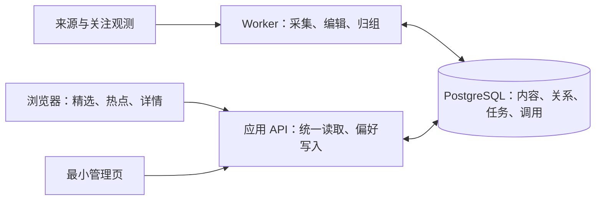

# Unspun 新生计划：最小架构与 AIHOT 对照

日期：2026-11-04。**这是待讨论的架构建议，不是已批准的技术选型或开工计划。** 用户本轮同意编制本对照方案；产品范围按 [D-053/D-054](../../decisions.md)、[产品定义](../../product-definition.md)和[需求](../../requirement.md)。本轮不创建新项目、不改运行、不执行来源采集或付费验证。

## 1. 建议与选择依据

建议优先评估 **独立仓库、按 Unspun 的内容模型实现、选择性移植 AIHOT 的可靠组件**。AIHOT 整体改造保留为对照路径；若后续小试验表明核心差异可以局部解决，且能保住大部分有效实现与回归测试，应重新考虑直接采用。现有证据不足以断言 fork 成本更高，也没有足够依据给出工期或复用百分比。

首版产品必须同时提供精选首页（全部／事件／文章／视频）、独立热点页及详情。中文跨领域供给、独立好文章、可读的中文整理和明确偏好是核心要求。视频无稳定供给时隐藏入口；独立刊物和完整主题目录不进入首版。

选择独立实现作为优先候选的主要理由，是产品对象和发布条件的差异，而非代码风格或框架偏好：事件应当有独立身份，合格文章无需等待事件归属，偏好需跨设备保存。若为这些要求反复绕过原有发布规则，长期维护分叉的收益可能低于重建小范围业务层。

| 路线 | 可以保留的价值 | 需要承担的成本 | 选择条件 |
| --- | --- | --- | --- |
| A：整体采用 AIHOT 后改造 | 现成采集、编辑、归组、阅读和后台；原有测试 | 内容契约与发布流程适配、刊物及无关出口退役、偏好扩展、后续上游合并 | 核心差异可在明确边界内完成，保留下来的能力通过同一组验证 |
| B：独立实现业务层，选择性移植（建议优先评估） | 好的设计、可独立提取的工具、提示词结构、测试样本 | 新内容模型、发布读取、页面与业务集成；移植也需剥离依赖 | 保留的可靠能力有实际价值，业务规则清楚，验证成本可控 |
| C：独立实现，主要借鉴设计 | 可以完全围绕目标组织代码 | 采集、恢复、发布等运行经验必须重新实现和验证 | 代码移植依赖过重，或技术栈不同；仍使用成熟库，不自造基础设施 |

## 2. 对照证据及其限度

AIHOT 取固定提交 [cd424b0](https://github.com/KKKKhazix/AIHOT/tree/cd424b0a513c7c8535b6f291b106a3086d6b75bf)。已只读抽查源码，并核对该提交的 [check/docker CI 成功](https://github.com/KKKKhazix/AIHOT/actions/runs/41619990731)。本地未安装依赖、运行系统或验证模型效果；上游通过不等于 Unspun 的中文来源、跨领域选材和目标部署已经通过。

| 能力 | AIHOT 的实际实现 | Unspun 的建议取舍 |
| --- | --- | --- |
| 模块边界 | web 经 HTTP 访问后端，公开出口经 publication；有[边界测试](https://github.com/KKKKhazix/AIHOT/blob/cd424b0a513c7c8535b6f291b106a3086d6b75bf/tests/architecture.test.ts#L47) | 吸收集中读取、领域模块负责写入的原则；不建设通用插件平台 |
| 采集与材料身份 | 多类来源统一进入[材料入口](https://github.com/KKKKhazix/AIHOT/blob/cd424b0a513c7c8535b6f291b106a3086d6b75bf/packages/backend/src/content/materials.ts)；入口依赖发布、出处和模块系统 | 优先评估 URL、日期、解析工具及其测试；整条材料入口不能按单文件直接搬运估算 |
| 筛选与写作 | [规则与门槛](https://github.com/KKKKhazix/AIHOT/blob/cd424b0a513c7c8535b6f291b106a3086d6b75bf/industry/selection.ts)可配置，当前是 AI 行业标准 | 学习先筛再写、区分标题/摘要/理由；重做跨领域标准，用同批样本比较，不直接继承分数和调用次数 |
| 事件与独立内容 | 有 story/fact、多对多材料关系及 standalone 分支；但[精选资格](https://github.com/KKKKhazix/AIHOT/blob/cd424b0a513c7c8535b6f291b106a3086d6b75bf/packages/backend/src/publication/publish.ts#L294)统一要求归组完成 | 学习关系判断；独立内容的阅读资格和事件归属判断分开。不是“AIHOT 无事件就不能发表” |
| 精选类型 | [时间线](https://github.com/KKKKhazix/AIHOT/blob/cd424b0a513c7c8535b6f291b106a3086d6b75bf/packages/backend/src/publication/timeline.ts)以文章代表 fact，筛选为 channel/category/tag；热点使用 story | 明确 event/article/video 契约，联动筛选、分页和缓存；不可仅把现有标签改名 |
| 热点 | [来源主体去重与热度观测](https://github.com/KKKKhazix/AIHOT/blob/cd424b0a513c7c8535b6f291b106a3086d6b75bf/packages/backend/src/events/hot.ts#L106)包含撤回、隔离来源和采集滞后处理 | 学习证据及缺口表达；时间窗口、衰减和参与方阈值按跨领域样本验证 |
| 偏好 | [已读和收藏](https://github.com/KKKKhazix/AIHOT/blob/cd424b0a513c7c8535b6f291b106a3086d6b75bf/apps/web/app/lib/local-state.ts)保存在浏览器 | 新建服务端单用户偏好与可撤销反馈；不能拿本地收藏代替兴趣及跨设备保存 |
| 任务与费用 | pg-boss 持久队列；[付费回执](https://github.com/KKKKhazix/AIHOT/blob/cd424b0a513c7c8535b6f291b106a3086d6b75bf/packages/backend/src/providers/receipts.ts#L226)检查请求次数；[未知结果](https://github.com/KKKKhazix/AIHOT/blob/cd424b0a513c7c8535b6f291b106a3086d6b75bf/packages/backend/src/operations/recover.ts#L40)半小时后自动放行一次 | 学习持久化与结果复用；次数限制不等于金额上限，不直接继承未知请求自动重发政策 |
| 刊物与出口 | [排程](https://github.com/KKKKhazix/AIHOT/blob/cd424b0a513c7c8535b6f291b106a3086d6b75bf/apps/worker/src/schedules.ts#L26)内置刊物生成，导航隐藏不等于任务停止 | 独立实现不带入；fork 试验需一起核对任务、告警、页面和对外出口 |
| 部署与恢复 | [Compose](https://github.com/KKKKhazix/AIHOT/blob/cd424b0a513c7c8535b6f291b106a3086d6b75bf/docker-compose.yml)分角色启动，[备份测试](https://github.com/KKKKhazix/AIHOT/blob/cd424b0a513c7c8535b6f291b106a3086d6b75bf/tests/backup.test.ts)包含数据库及文件恢复 | 学习迁移先行和实际恢复验证；新项目只保留必要进程，自己的数据仍需恢复演练 |

以上“复用”均为候选。移植时记录上游提交、文件、依赖和对应测试，保留适用的版权与许可说明；通过新样本前，不标为已验证的 Unspun 能力。

## 3. 最小架构

采用一个后端代码库，按业务职责分模块，运行 API 和 worker 两种进程；共用一个 PostgreSQL。前端构建为静态资源，通过同源入口访问 API。来源请求与模型调用只在 worker 执行，读页面不产生模型费用。

代码只需形成六个清楚的职责：来源与材料、筛选与编辑、事件与热度、发布读取、偏好反馈、运行任务。它们是同一应用内的模块，不拆成六个服务。配置集中放来源、领域、选材与写作规则；用户偏好放数据库。后台调用所属模块的操作，不另写一套修改状态的逻辑。

首版不需要 Redis、独立搜索服务、向量数据库服务、通用工作流编排器或插件市场。事件召回先用时间、主体与词项缩小范围；必要时增加数据库内向量检索，由真实漏召样本证明其收益。排序先使用可解释的价值、时效、兴趣和多样性规则，不建设行为学习模型。

**技术栈候选：** 优先验证 TypeScript + React/Vite + Fastify + PostgreSQL + pg-boss，以降低吸收 AIHOT 工具和测试的语言转换成本。[pg-boss](https://github.com/timgit/pg-boss)用于持久队列与调度；应用仍负责外部调用的幂等与未知状态。版本在实际原型前固定，本方案不指定“最新版本”或直接照搬上游锁文件。

Python + FastAPI 也是可行对照：若实际保留下来的主要是现有 Python 来源解析器，而 AIHOT 大多只能借鉴设计，继续 Python 可能更省维护成本。不能只为队列库更换语言，也不在首版维护两套后端。语言选择由可移植组件的小验证决定，不是已经批准的迁移。

## 4. 内容模型与阅读行为

以下是概念职责，不是要求建立同名表或完整框架。

| 对象 | 最小语义 |
| --- | --- |
| 来源与材料观测 | 原始 URL、来源/作者、原发时间及可信程度、发现时间、材料完整度、内容修订和转载关系；归一化后仍保留各来源观测 |
| 内容 Content | article/video；帖子归文章，观点/知识/访谈为标签。保存可得正文或字幕、原文入口、中文卡片和可选导读；零事件关系也可入选 |
| 事件 Event 与进展 | 事件围绕明确发生或讨论焦点的一件事；进展是有材料支持的具体变化。长期领域或主体名称不直接成为事件；改写概况、转载或热度上涨不创建新进展 |
| 内容关联 | 内容与事件/进展多对多，注明报道、解释、观点、背景或提及，并有依据与确认状态；撤销一项关系不删除内容，也不取消其他有效关系 |
| 关注观测 | 平台、观测时间、指标及来源主体；从中推导热度与趋势。报道数量、独立来源与平台关注分开，缺少观测时为未知 |
| 精选读取 | 引用事件或内容，返回 event/article/video 三类卡片；各有入选理由和有效版本。“全部”只混排精选，不读取全采集池 |
| 偏好与反馈 | 服务端保存领域/话题关注、作者/来源偏好及内容/事件反馈；支持修改、撤销、冲突处理和跨设备重读。一次反馈不扩大为对整个领域的态度 |

精选和热点共用事件身份与详情。文章可以关联事件并独立入选，纯重复报道主要通过事件卡呈现；独立分析不因归组被永久隐藏。一次内容更正或撤回，应让列表、详情和依赖它的事件文本一致更新，相关判断历史可复核。

类型筛选先于分页，游标绑定类型与排序版本，返回页面时恢复浏览位置；新内容到来不应让翻页反复出现同一项。阅读不自动隐藏内容。热点排序与精选排序独立，热点不自动占据全部精选位置。

偏好设置使用轻量入口和详情内关注操作，不增加一个完整主题目录。保存尚未接入的作者/来源偏好时显示待接入，不能暗示已开始采集。话题关注的具体匹配范围要在方案样本中展示，不能只保存一个按钮状态。

## 5. 从来源到成品的最短流程

1. **发现与取材：** 定期采集元数据，按需补正文；先做 URL/内容去重和明显无效筛除。保留原发、发现、材料取得和可读发布时间。
2. **判断与编辑：** 根据内容类型判断当前阅读价值，写清楚的中文标题、摘要和必要的推荐理由。新闻看变化与时效，观点/知识看主张、解释与启发；未知材料或时间不靠模型补造。
3. **独立入选：** 文章/视频达到材料、基本去重和阅读质量要求即可入选；事件归属待定不阻塞独立阅读。可选长导读失败，不撤销已合格卡片和原文入口。
4. **事件组织：** 对适合的内容召回候选、确认关系、识别实质进展，生成有依据的事件概况。未确认关联不进入事件证据；事件可从一份有效材料开始，不把多篇转载当作验证。
5. **选编与热点：** 精选平衡重要性、兴趣、阅读价值与多样性；热点根据实际关注观测计算。不同路径写入各自结果，通过统一读取规则展示。

写作产物要能独立读懂：摘要先说明核心内容，再给必要细节；阅读理由补充具体价值，不能复制第一条摘要充数。引用依据留在可核对的位置，界面按需展开，不要求每段正文都写成审查记录。文章保留作者的观点和适用语境；视频只有简介时明确展示简介，不伪造看过全片的导读。

模型步骤数量尚不定。先保留 AIHOT 的双评分等流程作为比较对象，再用同批材料比较质量、失败率、延迟和成本；不能因“少调用”直接合并所有判断，也不照搬一串尚无收益证据的模型步骤。

## 6. 必要的运行基础

- **任务与调用分开记录：** 使用成熟队列；调用有稳定请求身份、逐次尝试和原始结果。结果先保存再写业务结果，重启能复用；普通任务重试不能绕过付费策略。未知结果保留为未知，首版建议暂停该请求的再次付费，其他独立内容继续处理。
- **最小成本控制：** 请求次数限制和金额控制分别表达。建议使用统一金额上限、调用前估算预留与调用后核对；实际、估算、未知分开，不默认缺预算就无限放行。不预填新额度或模型，不引入逐阶段审批平台；现有系统账务边界保持。
- **最小后台：** 来源健康与最后新增、处理积压/失败、条目材料与整理结果、事件归属纠错、调用用量及未知状态。先做到看得懂问题、能局部修复，不建设通用流程编辑器。
- **部署与数据：** 同一后端镜像运行 API/worker，迁移完成后启动；正常关停先停止领取任务，再保存已返回结果。沿用单用户受保护入口的思路，原环境保持，新数据库和配置独立。版本化迁移、数据库及必要文件备份，实际恢复到空环境后核验阅读和任务。
- **验证边界：** 纯逻辑测试、数据库集成、浏览器主路径与少量恢复试验各守必要行为。模型/来源真实质量另用材料与阅读结果评估，不以 mock、测试数量或页面截图代替。

## 7. AIHOT 与旧 Unspun 的具体复用候选

| 对象 | 首选处理 | 复用前要证明什么 |
| --- | --- | --- |
| AIHOT URL/时间/正文解析工具、对应来源读取器 | 逐组件评估移植，保留原测试 | 脱离全站配置后仍成立；中文原发时间、身份、正文范围及未知情况正确 |
| AIHOT 筛选、内容理解、归组提示词 | 学习结构，改写为 Unspun 范围 | 不误筛非 AI 领域、小众好内容；中文成品准确且可读；门槛经样本比较 |
| AIHOT 调用回执、事务入队、读取资格 | 优先学习设计；可独立提取时再移植 | 不需要搬入无关模块；采用新业务规则后并发、重启、撤回测试仍有效 |
| AIHOT 页面布局与交互 | 参考阅读密度和层次，按已确认导航实现 | 事件卡、文章卡、热点和返回路径语义清楚，手机和电脑可用 |
| 旧 Unspun 来源解析经验与真实样本 | 按需提取到验证集或适配器 | 区分历史成功与当前可用；保留失败案例及原有评价含义 |
| 旧偏好/反馈、内容与费用记录 | 保留原系统；有明确需求时另设计导入 | 不是默认全量迁移；能保持身份、撤销与费用未知语义，导入可验证 |
| 旧任务链、自动话题结果、阶段框架 | 作为失败经验与行为测试参考 | 未验收能力不当作可靠核心直接搬入；不把旧阶段名称带进新领域模型 |

## 8. 首批比较与验证建议

目标是小范围完整阅读循环。样本数量和观察周期以下均为建议，不是已确认阈值或执行授权。小范围试验通过也不代表中文跨领域覆盖已完成。

**先做一套共同样本和阅读契约。** 建议约 24 条已有真实材料，至少覆盖三个领域，包含同事件多源报道、纯转载、后续进展、独立分析、无热点知识文章、一文涉及两事件、无依据材料和旧闻。视频有可用材料时加入；没有时验证入口隐藏并保留供给缺口。固定分析结果只用于比较架构行为，现有或后续真实模型产出另作内容质量证据。首个列表与事件／文章详情可读时就安排用户阅读，与后续工程验证并行，不等待所有恢复测试完成后才检查可读性。

**只验证决定选型的差异，不并行造两个完整产品。** 在 AIHOT 隔离副本先实现最小读取/发布适配；独立方案只提取一个来源工具并跑通必要模型与同样 API 行为。记录实际触及的模块、保留下来的测试、必须重写的规则和未完成项，避免把设计估算当实测工作量。

| 验证场景 | 必须观察到的结果 |
| --- | --- |
| 归组 pending 的合格文章／视频 | 可独立精选，未确认关系不会污染事件 |
| 新事件、转载与后续进展 | 精选和热点共用事件详情；转载不刷新进展，热度上涨不自动成为新事实。至少一组有时间变化的真实关注观测用于核对热点呈现与排序；没有观测则热点质量保持未测 |
| 事件相关分析及无事件知识文 | 文章可独立入选；事件关联可增删，一文两事件撤销其一不破坏另一项 |
| 精选类型与分页、返回 | 全部／事件／文章／视频结果正确，跨页无重复或漏项，视频无供给时入口隐藏 |
| 两个设备关注、反馈及撤销 | 服务端状态一致，同批候选下一次排序反映变化，浏览本身不产生兴趣或隐藏行为 |
| 更正、撤回与慢任务 | 列表、详情、事件依据一致；慢源或可选导读不阻塞其他合格内容 |
| 重复任务、并发额度与崩溃窗口 | 不重复产生业务结果；已持久化且匹配请求身份的结果直接复用。发送后或收到响应但落库前崩溃时保留未知，不由普通重试再次发送；分别验证这两个窗口 |
| 停用刊物与恢复 | 无生成任务、缺刊告警及残留产品出口；备份在空环境恢复后可读、可继续处理 |

在共同样本试读与必要的运行保护具备后，逐步验证自然新增：建议先用 3–5 条可接入来源，覆盖新闻、观点/知识和技术等不同贡献，并取得实际关注信号随时间变化的观测，检查热点更新与延迟。单列国内重要领域及指定来源的缺口，不把示范 AI 源当作完整来源方案；缺少真实热点信号时，热点质量与时效不能用空页面或固定模型结果代替。建议连续三天阅读与观察自然新增；这只能支持首轮试用结论，不能宣称长期稳定。

记录原发→发现→可读的延迟及每段耗时，分别判断来源滞后、排队和处理问题；原发不明的材料不计入可核验时效分母。用户阅读精选、热点和详情，判断值得看、是否读懂、重复与遗漏；同时检查被筛掉的材料。回放不冒充实时捕获，AI 自评不代替用户体验。付费和来源请求的执行范围、额度及停止条件须在实际试验前具体化；本轮不执行。

## 9. 选型出口与下一份交付

若 AIHOT 适配主要集中在明确的内容类型与发布边界，材料处理、任务恢复、热度证据等能连同有效回归保留，可选择路线 A。刊物可完整停用、偏好扩展清楚、升级差异可解释，都属于这项判断。

若必须同时重做材料身份、处理状态、事件归属和发布主体，或为普通文章不断增加旁路规则，应转向 B；若可移植代码连同依赖和测试的成本仍明显高于自行实现，再选择 C。文件数量和代码行数只用于描述规模，不作为唯一门槛。任何路线都要经过同一组阅读、恢复和真实质量验证。

本方案建议下一份交付为“选型验证结果与开工范围”：列明实际保留/改写对象、技术栈及版本、首批来源和预算、最小页面与数据范围、未解决风险及回退方式。得到具体结果后再确定正式仓库及实施任务，不把方案文档、静态审查或旧 R2 的勾选当作新产品已交付。
